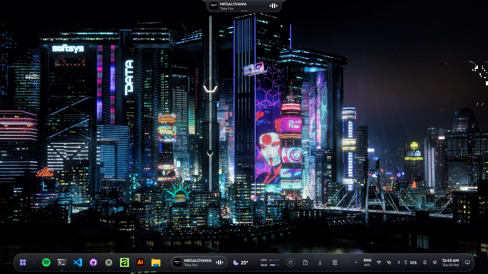
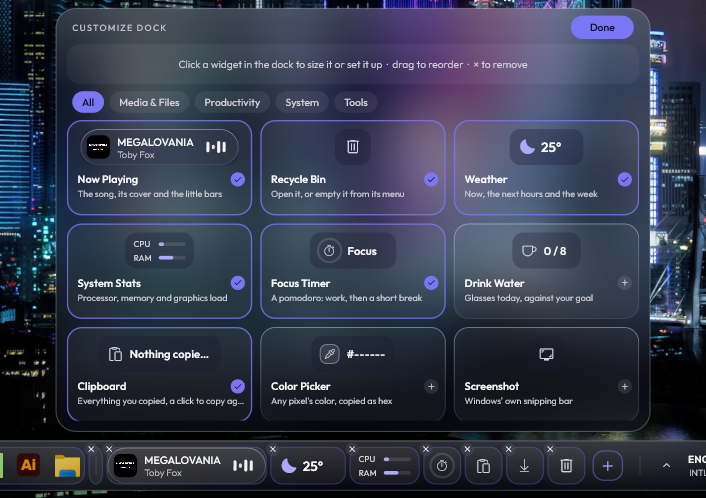
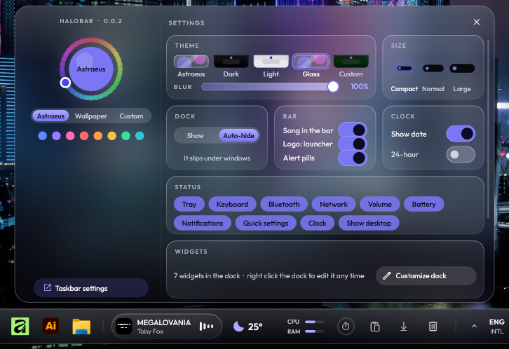
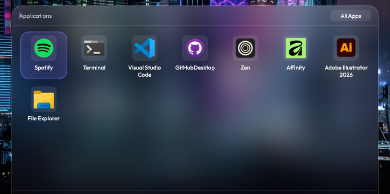
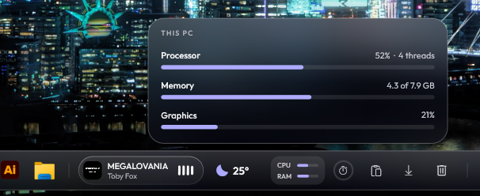
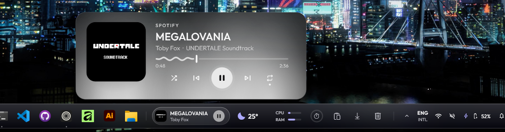
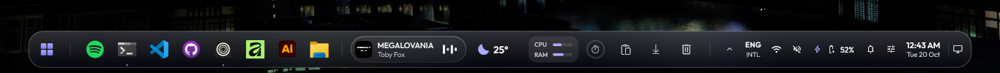
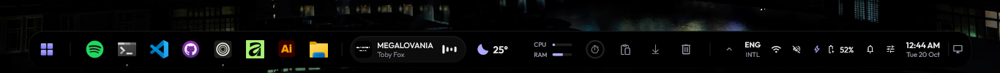
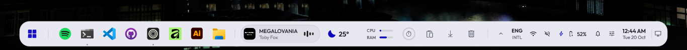

<div align="center">



# HaloBar

**A floating dock for Windows 11, with widgets you pick and arrange yourself.**

[](https://github.com/Icetist/HaloBar/releases/latest)
[](https://github.com/Icetist/HaloBar/releases)
[](https://github.com/Icetist/HaloBar/actions/workflows/release.yml)


[Features](#-features) •
[Screenshots](#-screenshots) •
[Performance](#-performance) •
[Installation](#-installation) •
[Usage](#%EF%B8%8F-usage) •
[Building](#%EF%B8%8F-building-from-source) •
[FAQ](#-faq)



</div>

HaloBar replaces the Windows taskbar with a floating dock at the bottom or along either side of your screen: your apps, the widgets you choose and your status icons in one row. Click anything and a panel grows out of it, then settles back down. When a window covers it, it slips away and comes back the moment your mouse touches that edge.

It is a sibling of [Astraeus](https://github.com/Icetist/Astraeus). The two share their themes, their calendar and Do Not Disturb, and HaloBar leaves the top of the screen to Astraeus. But HaloBar runs entirely on its own: no Electron, no web view, no runtime to install. Just one small native executable written in C++ with Direct2D and DirectComposition.

<p align="center"><sub>If HaloBar makes your desktop a little nicer, consider leaving a ⭐. It genuinely helps.</sub></p>

## ✨ Features

- **Your apps.** Pinned and running apps, in the same order as the Windows taskbar, with live window previews, jump lists, per-app volume on scroll and a **+N** tile when they don't all fit.
- **Widgets, picked from a gallery.** Now playing, weather, system stats, clipboard, notes, calendar, focus timer and about twenty more, in small, medium and large, dragged wherever you like in edit mode.
- **A clipboard that keeps up.** Fuzzy search, pins, tabs for text, code, links, files, media and colours, code highlighting, colour swatches in any notation, tracking-free links and paste straight into the app you came from.
- **Quick settings and notifications.** Wi-Fi, Bluetooth, volume, brightness and a dozen toggles, joining networks and pairing devices in place, with your notifications beside a month view.
- **Your look.** Astraeus' themes (Dark, Light, Glass or Custom, plus Astraeus' own Starfall when following it), opacity and blur sliders, three sizes, a dock on every screen and any edge.
- **Out of a game's way.** A fullscreen game gets its screen to itself, while the docks on your other screens keep working.

<details>
<summary><b>More features</b></summary>

- **Your apps.** Pinned and running apps, in the same order and with the same pins as the Windows taskbar. Rest on one and its name rises above it; hover for live window previews, right-click for the app's windows and recent files, middle-click for a new window, and scroll over an app to change its own volume. Windows minimize into their icon. When they don't all fit, a **+N** tile holds the rest.
- **Drop files on an app.** Drag a file onto an app in the dock to open it there. Hold it over the app for a moment and its window comes up, so you can drop straight into it, as on the Windows taskbar.
- **Keyboard, as on Windows.** **Win + 1–9** opens, shows or tucks away the app in that spot, **Win + T** walks the dock with the arrow keys and Enter, and **Win + B** opens the tray.
- **Widgets, picked from a gallery.** Now playing, recycle bin, weather, system stats, network speed, battery, drives, focus timer, water, clipboard history (text and images), color picker, screenshot, emoji, downloads, a favourite folder, notes, to-do, habits, calendar, world clock, progress of the day and year, quick toggles, volume, search, app switcher and photo. Most come in small, medium and large, and every one shows its real face in the gallery before you add it. Widgets that show words, like weather, battery and network speed, are as wide as what they say.
- **Space.** Empty room between widgets, as wide as you drag it. When the dock gets crowded, the spaces give their room back to your apps first.
- **Edit mode.** Right-click the dock and everything in it can be dragged: widgets, dividers you add yourself, even the whole block of apps. Size each widget, set its options or remove it with its ×.
- **Status at the end of the row.** Tray, keyboard layout, Bluetooth, network, volume, battery, notifications, quick settings, the clock and show desktop, each one optional. The keyboard layout names itself (ENG UK, ENG INTL) and a click moves to the next one. Apps' own tray flyouts open right over their icon in the dock.
- **Quick settings.** Wi-Fi, Bluetooth, airplane mode, mobile hotspot, energy saver, night light, microphone, Do Not Disturb, live captions, cast, project, nearby sharing, accessibility and a snip, plus volume, brightness and every app's own volume. Join Wi-Fi networks and pair Bluetooth devices right in the panel.
- **Notifications and the calendar.** Your notifications beside a month view, with Do Not Disturb and Clear all. New ones rise as small pills, or from Astraeus when it's running. Connect Google Calendar, Outlook or iCloud with your calendar's private link: links are stored encrypted and shared with Astraeus.
- **Media.** The playing song with a small visualizer; click it for a player with album art, shuffle and repeat, and pause right from the dock. In a side dock the song becomes a tall pill with its title turned sideways and the visualizer at its end. With Astraeus running, click the album art for Astraeus' fullscreen player with lyrics; close it and you're back in the player.
- **Launcher.** Click the Windows logo to search every installed app, with your pins, power options and Windows Start one click away. **All apps** lists everything the way Start does, under letters, with folders that open in place.
- **Menus in HaloBar's style.** Right-click an app, the Windows logo or the recycle bin for a menu with icons, a header and submenus, in your theme.
- **Your look.** Astraeus' themes: follow Astraeus (Starfall included, with its violet glow drifting while you hover), or pick Dark, Light, Glass or Custom with your own accent and background. On the solid looks an opacity slider lets the desktop show through the dock and its panels, on glass a blur slider; following Astraeus, both are Astraeus' own. Compact, normal or large.
- **Every screen, any edge.** A dock on every screen, or on the one you pick from a little map of your monitors. Put it at the bottom (centered, from the left or from the right) or on the left or right edge; it moves there live, without the Windows taskbar flashing up in between.
- **Windows' taskbar, any time.** One button in settings hands the taskbar back to Windows; HaloBar waits as a tray icon whose little dashboard brings it back.
- **Updates itself** and **starts with Windows.** New releases install silently once their SHA-256 matches the one published with them.

</details>

## 📸 Screenshots

<table>
  <tr>
    <td width="50%"></td>
    <td width="50%"></td>
  </tr>
  <tr>
    <td align="center"><b>Edit mode and the widget gallery</b></td>
    <td align="center"><b>Settings</b></td>
  </tr>
  <tr>
    <td width="50%"></td>
    <td width="50%"></td>
  </tr>
  <tr>
    <td align="center"><b>Launcher</b></td>
    <td align="center"><b>System stats</b></td>
  </tr>
</table>


<p align="center"><b>The player, out of the song in the dock</b></p>




<p align="center"><b>Glass, Dark and Light</b></p>

## ⚡ Performance

HaloBar draws only while something on it moves, and only the part that moved. With nothing changing it sleeps: no redraws, Windows efficiency mode, and its memory handed back. Slow work like reading the network, the recycle bin or app icons happens off the drawing thread, and each widget's data only flows while that widget is in the dock.

A blinking caret books one frame per blink instead of redrawing its panel all the time, the visualizer's frames repaint only the little square the bars live in, without working out curves and outlines that can't reach it, and the glass outline is handed to Windows only when it actually moves.

Behind a fullscreen game it draws nothing, stops its status checks, unhooks other apps' window events and steps down in priority, unless a dock on another screen is still in use. Busy animations are held to 60 fps, so a 144 or 240 Hz screen doesn't multiply the cost.

Measured on a 4-thread laptop at 1366×768:

| | CPU | Memory (private) | GPU memory |
|---|---|---|---|
| Idle, dock tucked away | ~7.6 ms per second | ~33 MB | ~2 MB |
| Fullscreen game in front | 0.2% of one core | ~37 MB | 0% GPU use |

## 📦 Installation

1. Download `HaloBar.exe` from the [latest release](https://github.com/Icetist/HaloBar/releases/latest).
2. Run it from anywhere. HaloBar installs itself to `%LOCALAPPDATA%\Programs\HaloBar`, adds itself to the Start menu and runs from there.

The Windows taskbar steps aside while HaloBar runs and comes back the moment it exits. HaloBar starts with Windows from then on and keeps itself up to date.

> [!NOTE]
> The executable is not code-signed yet, so Windows SmartScreen may show an "unknown publisher" warning the first time. Click **More info → Run anyway**.

## 🖱️ Usage

- **Edit the dock:** right-click an empty spot on it, or choose **Customize dock** in settings.
- **Settings:** the gear in the launcher, or **HaloBar settings** in quick settings.
- **The player:** click the song. Its play button pauses straight from the dock.
- **Notifications and the calendar:** click the clock.
- **The tray:** click the arrow, or press **Win + B**.
- **Power options and Windows' own tools:** right-click the Windows logo.
- **Show desktop:** click the far right end of the dock.
- **Move the dock:** settings → **Position** for the edge, **Screens** for which monitors get one.
- **Open a file with an app:** drag it onto the app in the dock.

## 🛠️ Building from source

Requires Visual Studio 2022 or later with the C++ desktop workload and a Windows 11 SDK.

```
build.cmd
```

The executable lands in `build\HaloBar.exe`. Fonts are built into it.

## ❓ FAQ

<details>
<summary><b>How do I get the Windows taskbar back?</b></summary>

Open HaloBar's settings and choose **Go back to Windows taskbar**. HaloBar stays in the tray; click its icon and choose **Bring back HaloBar** whenever you want it again. Exiting HaloBar from the Windows logo's right-click menu brings the Windows taskbar back too, and it also returns on its own if HaloBar ever closes unexpectedly.

</details>

<details>
<summary><b>Do I need Astraeus?</b></summary>

No. HaloBar works on its own. With Astraeus installed, the two share their look, calendar and Do Not Disturb, Astraeus shows your notifications, and HaloBar keeps Astraeus above the dock.

</details>

<details>
<summary><b>Does it work with more than one screen?</b></summary>

Yes. HaloBar puts a dock on every screen, as Windows does. In settings, **Screens** shows your monitors as they stand: pick one for a single dock there, or keep every screen. The tray and notifications stay with the main one. While HaloBar runs, the Windows taskbar stays off every screen, and comes back as you had it when HaloBar exits.

</details>

## 🙏 Credits

- [Outfit](https://github.com/Outfitio/Outfit-Fonts) by the Outfit Project Authors, licensed under the [SIL Open Font License 1.1](./LICENSES/Outfit-OFL.txt).
- [Material Symbols](https://github.com/google/material-design-icons) by Google, licensed under the [Apache License 2.0](./LICENSES/MaterialSymbols-Apache-2.0.txt).
- Weather from [Open-Meteo](https://open-meteo.com).
